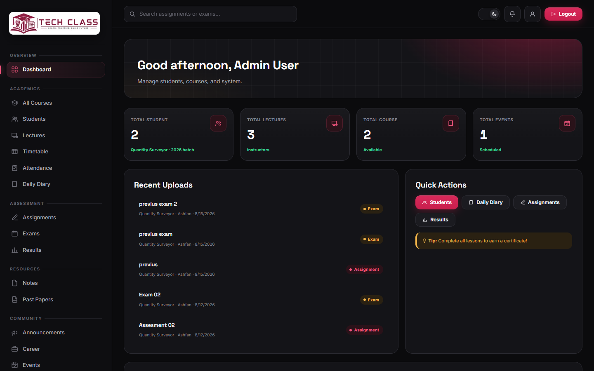
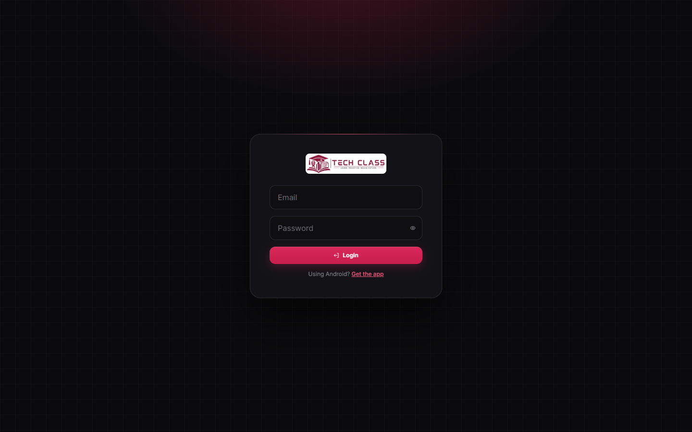
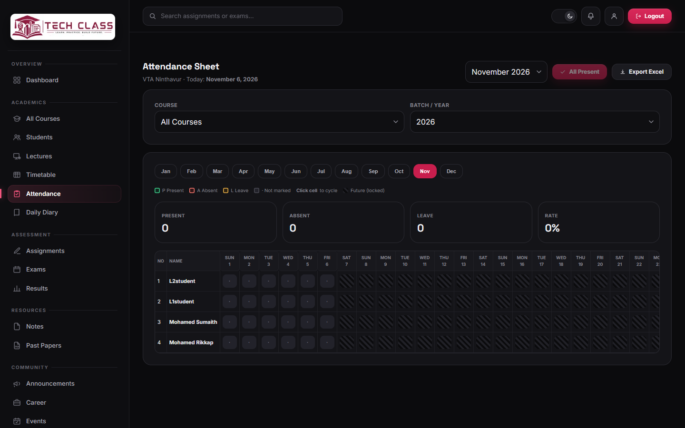
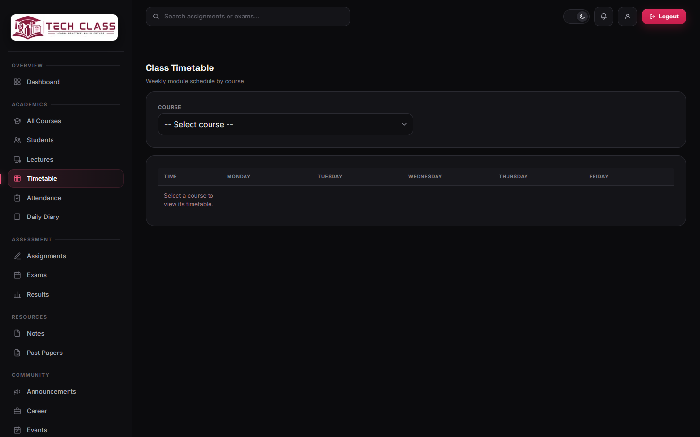
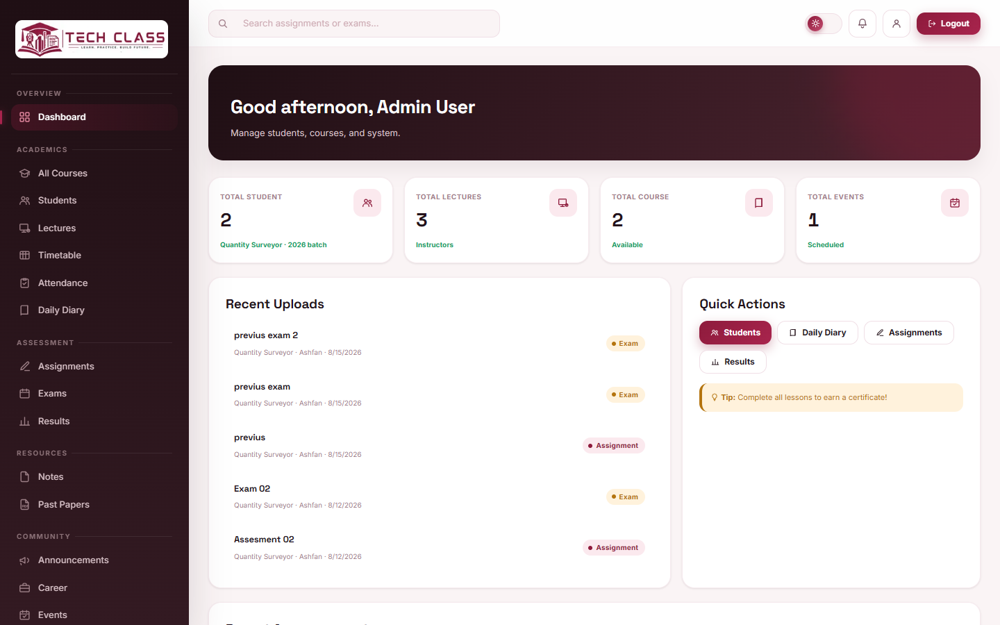
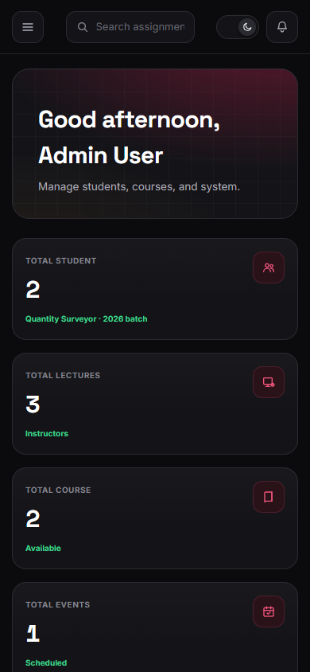

<div align="center">


# VTA QS LMS

A learning management system for a Quantity Surveying (NVQ) class: courses, attendance, daily diary, assignments, exams, results and announcements in one place for admins, instructors and students.


</div>



## Features

| Area | What it covers |
|---|---|
| Overview | Dashboard with student, lecture, course and event counts, recent uploads and quick actions |
| Academics | Courses, students, lectures, timetable, attendance by month, daily diary with print layout |
| Assessment | Assignments with submissions, exams, results |
| Resources | Notes and past papers with file upload and PDF preview |
| Community | Announcements, career listings (jobs and internships), events with photos |
| Accounts | Three roles (admin, instructor, student) with session login |
| Interface | Dark theme by default with a light theme toggle, works on phones, installable Android app |

## Screenshots

| Login | Attendance |
|---|---|
|  |  |
| **Timetable** | **Light theme** |
|  |  |

<p align="center"></p>

## Research document

[**docs/Research-Document.pdf**](docs/Research-Document.pdf) describes every function of the system with screenshots, the architecture, the data model, business rules, security, the full API and known limitations. It is written for anyone researching or writing about the system.

The PDF is generated from [docs/research/research-document.html](docs/research/research-document.html). After editing the HTML, rebuild it with `node docs/research/build-pdf.mjs` (needs Node.js 22+ and Chrome or Edge).

## Tech stack

- **Backend:** plain PHP with PDO, no framework and no Composer packages
- **Database:** MySQL or MariaDB (`schema.sql`)
- **Frontend:** a single-page app in `index.html`, `js/app.js` and `css/style.css`, no build step
- **Server:** Apache with `mod_rewrite`; `.htaccess` sends `/api/*` to `api/index.php`

## Getting started (XAMPP on Windows)

1. Install [XAMPP](https://www.apachefriends.org/) and start **Apache** and **MySQL**.
2. Clone the repo into `htdocs`:
   ```bash
   cd C:\xampp\htdocs
   git clone https://github.com/mercyblack011/vta-qs-lms-php-final.git vta-qs-lms
   cd vta-qs-lms
   ```
3. Create your config file. The defaults match a fresh XAMPP install (user `root`, no password):
   ```bash
   copy .env.example .env
   ```
4. Create the database, tables and demo data:
   ```bash
   C:\xampp\php\php.exe setup.php
   ```
5. Open <http://localhost/vta-qs-lms/>.

The app has to be served by Apache. Opening `index.html` straight from the file system will not work, because the API needs PHP and the rewrite rules.

### Demo accounts

`setup.php` creates these on an empty database. All use the password `password123`.

| Role | Email |
|---|---|
| Admin | `admin@vta.lk` |
| Instructor | `instructor@vta.lk` |
| Student | `student@vta.lk` |

Change these passwords before the app is used by real people.

## Configuration

`.env` (copied from `.env.example`):

| Key | Default |
|---|---|
| `DB_HOST` | `127.0.0.1` |
| `DB_PORT` | `3306` |
| `DB_USER` | `root` |
| `DB_PASSWORD` | *(empty)* |
| `DB_NAME` | `vta_lms` |

`.env` is ignored by git, and `.htaccess` blocks web access to it and to `schema.sql`.

## Project structure

```
.
├── api/
│   ├── index.php        # API entry point: /api/<resource> loads routes/<resource>.php
│   ├── lib/             # bootstrap, database, auth, JSON responses, uploads
│   └── routes/          # one file per resource (students, attendance, exams, ...)
├── css/style.css        # all styles, light and dark theme tokens
├── js/app.js            # the single-page frontend
├── docs/screenshots/    # images used in this README
├── index.html           # app shell
├── download.html        # Android app download page
├── 404.html
├── schema.sql           # database schema
├── setup.php            # command-line setup and demo seed
└── .htaccess            # rewrites, access rules, caching
```

Uploaded files are saved to `uploads/` at runtime. That folder is not tracked by git and must be writable by the web server.

## API

Every request goes to `/api/<resource>/...` and is handled by `api/routes/<resource>.php`. Responses are JSON. Login uses a PHP session cookie (`HttpOnly`, `SameSite=Lax`). Routes call `require_auth()` for a logged-in user and `require_role()` for admin and instructor actions (both in `api/lib/auth.php`).

PHP does not parse file uploads on `PUT` or `PATCH`, so the frontend sends those as `POST` with a `_method` field and `api/index.php` switches the method back.

## Android app

`download.html` serves the Android build (`VTA-QS-LMS.apk`, version 1.8, named Tech Class on the phone). It needs Android 7.0 or newer.

## Deploying

- Point `.env` at the production database and use a database user other than `root`.
- Run `setup.php` once from the server's command line. It refuses to run from a browser.
- Make `uploads/` writable by the web server.
- `.htaccess` sets `ErrorDocument 404 /404.html`, which assumes the app sits at the domain root. In a subfolder, change that path.
- Replace or remove the demo accounts.
